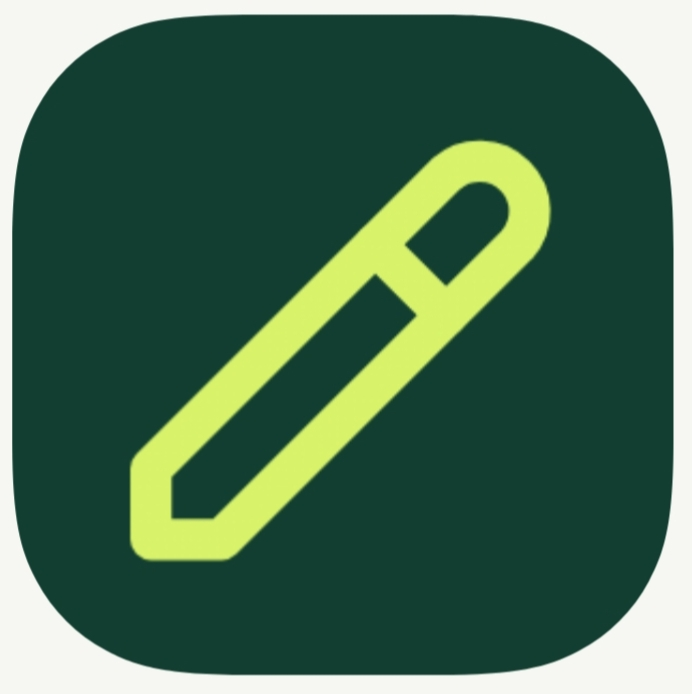

<!DOCTYPE html>
<html lang="ar" dir="rtl">
<head>
<meta charset="UTF-8">
<meta name="viewport" content="width=device-width, initial-scale=1">
<meta name="theme-color" content="#050b18">
<title>Outhub</title>

<!-- Firebase SDKs -->

</head>
<body>

<header>
  

    
    
Outhub

  

  <button id="accountButton" class="btn secondary hidden" style="width:auto;margin:0" onclick="showAccount()">حسابي</button>
</header>

<main class="container">

<!-- الحساب / تسجيل الدخول -->
<section id="authView" class="view">

  

    
    <h1>مرحبًا بك في Outhub</h1>
    
منصتك لإنشاء مشاريعك الرقمية.

  

  <!-- تسجيل الدخول -->
  

    <h2>تسجيل الدخول</h2>
    <button class="btn google-btn" type="button" onclick="loginWithGoogle()">تسجيل الدخول بواسطة Google</button>
    
أو بالبريد الإلكتروني

    <form id="loginForm">
      

        <label for="loginEmail">البريد الإلكتروني لحساب Outhub</label>
        <input id="loginEmail" type="email" required autocomplete="username" placeholder="البريد الإلكتروني">
      

      

        <label for="loginPassword">كلمة المرور</label>
        <input id="loginPassword" type="password" required autocomplete="current-password" placeholder="كلمة المرور">
      

      <button class="btn primary" type="submit">تسجيل الدخول</button>
    </form>
    

    

      <button class="link" type="button" onclick="showRegister()">إنشاء حساب</button>
      <button class="link" type="button" onclick="showForgot()">نسيت كلمة المرور؟</button>
    

  

  <!-- إنشاء حساب -->
  

    <h2>إنشاء حساب جديد</h2>
    
استخدم بريدك في Eisen Mail لاستلام رمز التحقق.

    

      

        يرجى استخدام بريدك المستعمل في Eisen Mail
      

      <form id="requestCodeForm">
        

          <label for="registerEmail">بريد Eisen Mail</label>
          <input id="registerEmail" type="email" required autocomplete="email" placeholder="أدخل بريدك المستعمل في Eisen Mail">
        

        <button class="btn primary" type="submit">إرسال رمز التحقق</button>
      </form>
    

    

      

        أدخل رمز التحقق الذي وصلك في صندوق الوارد داخل Eisen Mail.
      

      <form id="verifyForm">
        

          <label for="verifyCode">رمز التحقق (6 أرقام)</label>
          <input id="verifyCode" inputmode="numeric" maxlength="6" pattern="[0-9]{6}" required placeholder="000000">
        

        

          <label for="registerPassword">كلمة مرور حساب Outhub</label>
          <input id="registerPassword" type="password" minlength="6" required autocomplete="new-password" placeholder="6 أحرف على الأقل">
        

        <button class="btn primary" type="submit">التحقق وإنشاء الحساب</button>
      </form>
      <button class="link" type="button" onclick="backToEmail()">تغيير البريد الإلكتروني</button>
    

    

    

      <button class="link" type="button" onclick="showLogin()">لدي حساب بالفعل</button>
    

  

  <!-- استعادة الحساب -->
  

    <h2>استعادة كلمة المرور</h2>
    
أدخل البريد المرتبط بحساب Outhub.

    <form id="forgotForm">
      

        <label for="forgotEmail">البريد الإلكتروني</label>
        <input id="forgotEmail" type="email" required placeholder="بريدك الإلكتروني">
      

      <button class="btn primary" type="submit">طلب الاستعادة</button>
    </form>
    

    <button class="link" type="button" onclick="showLogin()">العودة لتسجيل الدخول</button>
  

</section>

<!-- الرئيسية -->
<section id="homeView" class="view hidden">
  

    <h1>مشاريعك تبدأ من Outhub</h1>
    
مساحة واحدة للانطلاق بمواقعك الإلكترونية وتطبيقاتك.

    <button class="btn primary" style="width:auto" onclick="showWebsite()">+ ابدأ مشروعك</button>
  

  

    <article class="card project-card">
      
🌐

      <h3>إنشاء موقع إلكتروني</h3>
      
جهّز تفاصيل مشروعك وانتقل إلى GitHub لإنشاء مستودع جديد.

      <button class="btn primary" onclick="showWebsite()">إنشاء موقع</button>
    </article>
    <article class="card project-card">
      
📱

      <h3>إنشاء تطبيق</h3>
      
احفظ فكرة التطبيق وانتقل إلى أداة إنشاء التطبيقات.

      <button class="btn primary" onclick="showApp()">إنشاء تطبيق</button>
    </article>
    <article class="card project-card">
      
✦

      <h3>Gemalot</h3>
      
افتح الخدمة عبر موقعها.

      <a class="btn secondary" href="https://mohamedmadoui5195.github.io/Gemalot/" target="_blank" rel="noopener">فتح Gemalot</a>
    </article>
    <article class="card project-card">
      
📂

      <h3>مشاريعي</h3>
      
اعرض المشاريع التي حفظتها على هذا المتصفح.

      <button class="btn secondary" onclick="showProjects()">عرض مشاريعي</button>
    </article>
  

  <h2 class="section-title">آخر المشاريع</h2>
  

</section>

<!-- إنشاء موقع -->
<section id="websiteView" class="view hidden">
  

    <h2>إنشاء موقع إلكتروني</h2>
    <form id="websiteForm">
      

        <label for="websiteName">اسم المشروع</label>
        <input id="websiteName" required placeholder="اسم الموقع">
      

      

        <label for="websiteIdea">فكرة الموقع</label>
        <input id="websiteIdea" required placeholder="اشرح فكرة الموقع">
      

      

        <label for="repoName">اسم مستودع GitHub</label>
        <input id="repoName" required pattern="[A-Za-z0-9._-]+" placeholder="my-website">
      

      

        <label for="visibility">خصوصية المستودع المطلوبة</label>
        <select id="visibility">
          <option value="private">خاص — Private</option>
          <option value="public">علني — Public</option>
        </select>
      

      

        سيُفتح GitHub لإكمال إنشاء المستودع. يجب تأكيد الخصوصية هناك؛ حفظ المشروع في Outhub لا ينشئ مستودع GitHub تلقائيًا.
      

      <button class="btn primary" type="submit">حفظ والانتقال إلى GitHub</button>
    </form>
    

    <button class="btn secondary" type="button" onclick="showHome()">العودة إلى الرئيسية</button>
  

</section>

<!-- إنشاء تطبيق -->
<section id="appView" class="view hidden">
  

    <h2>إنشاء تطبيق</h2>
    <form id="appForm">
      

        <label for="appName">اسم التطبيق</label>
        <input id="appName" required placeholder="اسم التطبيق">
      

      

        <label for="appIdea">فكرة التطبيق</label>
        <input id="appIdea" required placeholder="ما وظيفة التطبيق؟">
      

      <button class="btn primary" type="submit">حفظ وفتح أداة الإنشاء</button>
    </form>
    

    <button class="btn secondary" type="button" onclick="showHome()">العودة إلى الرئيسية</button>
  

</section>

<!-- المشاريع -->
<section id="projectsView" class="view hidden">
  

    <h2>مشاريعي</h2>
    

    <button class="btn primary" type="button" onclick="showHome()">العودة إلى الرئيسية</button>
  

</section>

<!-- الحساب -->
<section id="accountView" class="view hidden">
  

    <h2>حسابي</h2>
    

    <button class="btn secondary" type="button" onclick="showHome()">العودة إلى الرئيسية</button>
    <button class="btn danger" type="button" onclick="logout()">تسجيل الخروج</button>
  

</section>

</main>

<footer>Outhub — مساحة واحدة لمشاريعك الرقمية</footer>

</body>
</html>
