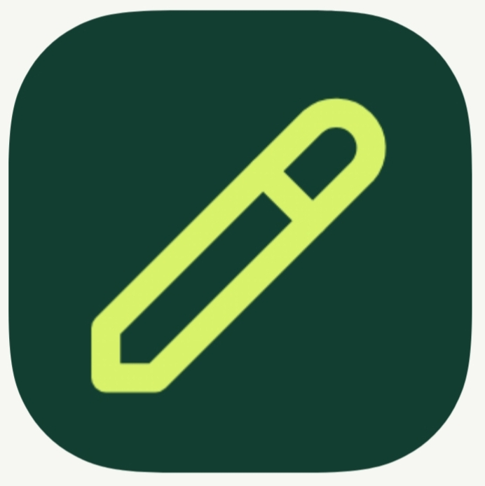

<!DOCTYPE html>
<html lang="ar" dir="rtl">
<head>
<meta charset="UTF-8">
<meta name="viewport" content="width=device-width, initial-scale=1">
<meta name="theme-color" content="#050b18">
<title>Outhub</title>

<!-- Firebase SDKs -->

</head>
<body>

<header>
  

    
    
Outhub

  

  <button id="accountButton" class="btn secondary hidden" style="width:auto;margin:0" onclick="showAccount()">حسابي</button>
</header>

<main class="container">

<section id="authView" class="view">

  

    
    <h1>مرحبًا بك في Outhub</h1>
    
منصتك لإنشاء مشاريعك الرقمية.

  

  

    <h2>تسجيل الدخول</h2>
    <button class="btn github-btn" type="button" onclick="loginWithGitHub()">تسجيل الدخول بواسطة GitHub</button>
    
أو بالبريد الإلكتروني

    <form id="loginForm">
      

        <label for="loginEmail">البريد الإلكتروني لحساب Outhub</label>
        <input id="loginEmail" type="email" required autocomplete="username" placeholder="البريد الإلكتروني">
      

      

        <label for="loginPassword">كلمة المرور</label>
        <input id="loginPassword" type="password" required autocomplete="current-password" placeholder="كلمة المرور">
      

      <button class="btn primary" type="submit">تسجيل الدخول</button>
    </form>
    

    

      <button class="link" type="button" onclick="showRegister()">إنشاء حساب</button>
      <button class="link" type="button" onclick="showForgot()">نسيت كلمة المرور؟</button>
    

  

  

    <h2>إنشاء حساب جديد</h2>
    
استخدم بريدك في Eisen Mail لاستلام رمز التحقق.

    

      
يرجى استخدام بريدك المستعمل في Eisen Mail

      <form id="requestCodeForm">
        

          <label for="registerEmail">بريد Eisen Mail</label>
          <input id="registerEmail" type="email" required autocomplete="email" placeholder="أدخل بريدك المستعمل في Eisen Mail">
        

        <button class="btn primary" type="submit">إرسال رمز التحقق</button>
      </form>
    

    

      
أدخل رمز التحقق الذي وصلك في صندوق الوارد داخل Eisen Mail.

      <form id="verifyForm">
        

          <label for="verifyCode">رمز التحقق (6 أرقام)</label>
          <input id="verifyCode" inputmode="numeric" maxlength="6" pattern="[0-9]{6}" required placeholder="000000">
        

        

          <label for="registerPassword">كلمة مرور حساب Outhub</label>
          <input id="registerPassword" type="password" minlength="6" required autocomplete="new-password" placeholder="6 أحرف على الأقل">
        

        <button class="btn primary" type="submit">التحقق وإنشاء الحساب</button>
      </form>
      <button class="link" type="button" onclick="backToEmail()">تغيير البريد الإلكتروني</button>
    

    

    

      <button class="link" type="button" onclick="showLogin()">لدي حساب بالفعل</button>
    

  

  

    <h2>استعادة كلمة المرور</h2>
    
أدخل البريد المرتبط بحساب Outhub.

    <form id="forgotForm">
      

        <label for="forgotEmail">البريد الإلكتروني</label>
        <input id="forgotEmail" type="email" required placeholder="بريدك الإلكتروني">
      

      <button class="btn primary" type="submit">طلب الاستعادة</button>
    </form>
    

    <button class="link" type="button" onclick="showLogin()">العودة لتسجيل الدخول</button>
  

</section>

<section id="homeView" class="view hidden">
  

    <h1>مشاريعك تبدأ من Outhub</h1>
    
مساحة واحدة للانطلاق بمواقعك الإلكترونية وتطبيقاتك.

<article class="card project-card">
  
💻

  <h3>تعلم البرمجة مع مداد</h3>
  
هل تريد تعلم البرمجة؟ تعلم تنظيم وكتابة أكوادك باحترافية مع مداد.

  <button class="btn primary" onclick="openMedad()">
    
    الانتقال إلى مداد
  </button>
</article>

    <button class="btn primary" style="width:auto" onclick="showWebsite()">+ ابدأ مشروعك</button>
  

  

    <article class="card project-card">
      
🌐

      <h3>إنشاء موقع إلكتروني</h3>
      
أنشئ مشروعك مباشرة داخل Outhub واحصل على رابط حي فوري (مثل GitHub Pages).

      <button class="btn primary" onclick="showWebsite()">إنشاء موقع</button>
    </article>
    <article class="card project-card">
      
📱

      <h3>إنشاء تطبيق</h3>
      
احفظ فكرة التطبيق داخل المنصة واحصل على رابط خاص به.

      <button class="btn primary" onclick="showApp()">إنشاء تطبيق</button>
    </article>
    <article class="card project-card">
      
✦

      <h3>Gemalot</h3>
      
افتح الخدمة عبر موقعها.

      <a class="btn secondary" href="https://Alislamiah.github.io/Gemalot/" target="_blank" rel="noopener">فتح Gemalot</a>
    </article>
    <article class="card project-card">
      
📂

      <h3>مشاريعي</h3>
      
اعرض المشاريع التي حفظتها على هذا المتصفح.

      <button class="btn secondary" onclick="showProjects()">عرض مشاريعي</button>
    </article>
  

  <h2 class="section-title">آخر المشاريع</h2>
  

</section>

<section id="websiteView" class="view hidden">
  

    <h2>إنشاء موقع إلكتروني</h2>
    <form id="websiteForm">
      
<label for="websiteName">اسم المشروع</label><input id="websiteName" required placeholder="اسم الموقع">

      
<label for="websiteIdea">فكرة الموقع</label><input id="websiteIdea" required placeholder="اشرح فكرة الموقع">

      
<label for="repoName">اسم المشروع (للرابط)</label><input id="repoName" required pattern="[A-Za-z0-9._-]+" placeholder="my-website">

      
<label for="visibility">خصوصية المشروع</label><select id="visibility"><option value="private">خاص — Private</option><option value="public">علني — Public</option></select>

      
سيتم إنشاء المشروع مباشرة داخل Outhub وتوليد رابط حي له (مثل GitHub Pages) دون الحاجة إلى GitHub.

      <button class="btn primary" type="submit">إنشاء المشروع والحصول على الرابط الحي</button>
    </form>
    

    <button class="btn secondary" type="button" onclick="showHome()">العودة إلى الرئيسية</button>
  

</section>

<section id="appView" class="view hidden">
  

    <h2>إنشاء تطبيق</h2>
    <form id="appForm">
      
<label for="appName">اسم التطبيق</label><input id="appName" required placeholder="اسم التطبيق">

      
<label for="appIdea">فكرة التطبيق</label><input id="appIdea" required placeholder="ما وظيفة التطبيق؟">

      <button class="btn primary" type="submit">حفظ وفتح أداة الإنشاء</button>
    </form>
    

    <button class="btn secondary" type="button" onclick="showHome()">العودة إلى الرئيسية</button>
  

</section>

<section id="projectsView" class="view hidden">
  

    <h2>مشاريعي</h2>
    

    <button class="btn primary" type="button" onclick="showHome()">العودة إلى الرئيسية</button>
  

</section>

<!-- واجهة تفاصيل المشروع — مساحة عمل الملفات مثل GitHub -->
<section id="projectView" class="view hidden">
  

    <h2 id="projectTitle">عنوان المشروع</h2>
    

    

    <!-- أزرار الإجراءات -->
    

      <button class="btn primary" type="button" style="width:auto;margin:0" onclick="showCreateFilePanel()">＋ Create file</button>
      <button class="btn secondary" type="button" style="width:auto;margin:0" onclick="showUploadPanel()">⬆ Upload file</button>
      <button class="btn secondary" type="button" style="width:auto;margin:0" onclick="copyLiveUrl()">نسخ الرابط الحي</button>
    

    <!-- لوحة إنشاء ملف -->
    

      <h3 style="margin-bottom:12px">Create file</h3>
      

        <label for="newFileName">اسم الملف (مثال: index.html أو style.css)</label>
        <input id="newFileName" type="text" placeholder="index.html" autocomplete="off">
      

      

        <label for="newFileCode">الكود / المحتوى</label>
        <textarea id="newFileCode" rows="10" style="width:100%;padding:14px;border:1px solid #2a3e5b;border-radius:11px;background:#050e1d;color:white;outline:none;font-family:monospace;resize:vertical" placeholder="ضع الكود هنا..."></textarea>
      

      

        <button class="btn primary" type="button" style="width:auto;margin:0" onclick="createFileInProject()">Create</button>
        <button class="btn secondary" type="button" style="width:auto;margin:0" onclick="hideCreateFilePanel()">إلغاء</button>
      

      

    

    <!-- لوحة رفع ملف -->
    

      <h3 style="margin-bottom:12px">Upload file</h3>
      
Upload from:

      

        <button class="btn secondary" type="button" style="width:auto;margin:0" onclick="window.open('https://Alislamiah.github.io/Bingot/','_blank')">Bingot</button>
        <button class="btn secondary" type="button" style="width:auto;margin:0" onclick="window.open('https://Alislamiah.github.io/MGA-Code-Editor/','_blank')">MGA Code Editor</button>
        <button class="btn secondary" type="button" style="width:auto;margin:0" onclick="triggerDeviceUpload()">Default files / File manager / Galerie / Google photos / OneDrive</button>
      

      <input type="file" id="deviceFileInput" class="hidden" multiple accept="*/*" onchange="handleDeviceFiles(event)">
      
يمكنك اختيار ملفات من جهازك (مدير الملفات، المعرض، Google Drive، OneDrive... عبر منتقي النظام).

      <button class="btn secondary" type="button" style="width:auto;margin-top:10px" onclick="hideUploadPanel()">إغلاق</button>
      

    

    <!-- قائمة الملفات -->
    <h3 style="margin:18px 0 10px">ملفات المشروع</h3>
    

    <!-- محرر / عارض الكود -->
    

      <h3 id="currentFileTitle" style="margin-bottom:8px">الملف</h3>
      <textarea id="codeEditor" rows="14" style="width:100%;padding:14px;border:1px solid #2a3e5b;border-radius:11px;background:#050e1d;color:#e6edf3;outline:none;font-family:monospace;font-size:13px;resize:vertical;direction:ltr;text-align:left"></textarea>
      

        <button class="btn primary" type="button" style="width:auto;margin:0" onclick="saveCurrentFile()">حفظ الملف</button>
        <button class="btn secondary" type="button" style="width:auto;margin:0" onclick="refreshPreview()">تحديث المعاينة</button>
        <button class="btn danger" type="button" style="width:auto;margin:0" onclick="deleteCurrentFile()">حذف الملف</button>
      

      

    

    <!-- معاينة حية -->
    

      <h3 id="embedTitle">معاينة الموقع الحي</h3>
      

      

        <iframe id="embedFrame" title="معاينة المشروع" sandbox="allow-scripts allow-same-origin allow-popups allow-forms allow-downloads allow-top-navigation-by-user-activation" src="about:blank"></iframe>
      

      

      
الرابط الحي يفتح المشروع مباشرة داخل Outhub. يعمل على نفس المتصفح/الجهاز الذي أُنشئ فيه المشروع (التخزين محلي).

    

    <button class="btn secondary" type="button" onclick="showProjects()" style="margin-top:16px">العودة إلى مشاريعي</button>
    <button class="btn secondary" type="button" onclick="showHome()">العودة إلى الرئيسية</button>
  

</section>

<section id="accountView" class="view hidden">
  
<h2>حسابي</h2>

<button class="btn secondary" type="button" onclick="showHome()">العودة إلى الرئيسية</button><button class="btn danger" type="button" onclick="logout()">تسجيل الخروج</button>

</section>

</main>

<footer>Outhub — مساحة واحدة لمشاريعك الرقمية</footer>

</body>
</html>
